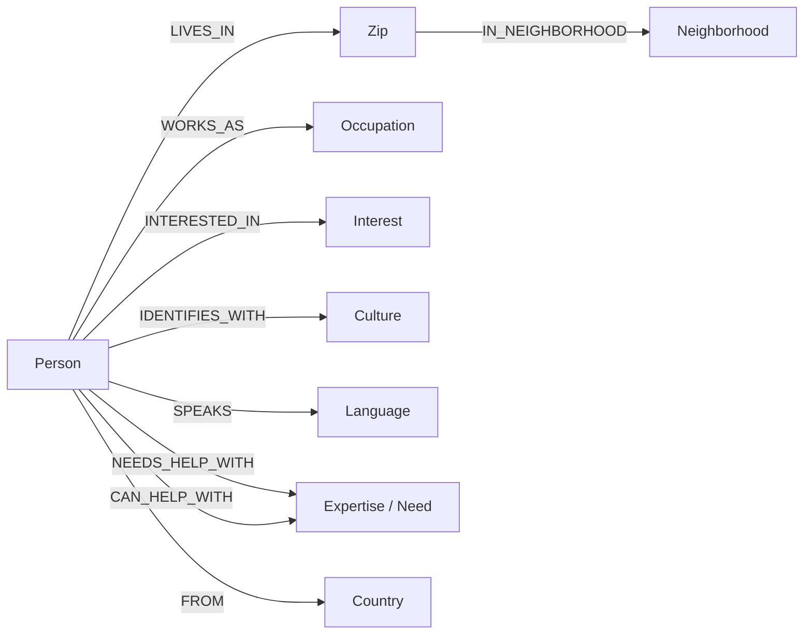

# View and use your relationship graph

## Local Docker graph

Open **http://localhost:7474** (Neo4j Browser). Connect to `bolt://localhost:7687`,
database `neo4j`, username `neo4j`, and the `NEO4J_PASSWORD` value in your local `.env`.
This is the host's database console; members continue to use the app at port 3000.

Run the first query below and select the **Graph** result view. Click a person to
inspect their display name; expand a node to see more connections. In the graph
style controls, set the Person caption to `name`, Zip to `code`, and other node
captions to `name` if Neo4j does not choose them automatically.

## Hosted Aura graph and MCP

For Aura, select the intended instance in the Aura console and verify its status before viewing its data. Use that instance's query interface and driver connection details. The local Browser URL above opens Docker Neo4j; it does not establish whether an Aura instance exists or contains the same data.

Neo4j MCP uses `https://<instance-id>.mcp-instances.neo4j.io`; the Python app uses the separate `neo4j+s://` driver URI with `NEO4J_USER` and `NEO4J_PASSWORD`. Follow the [official MCP setup](https://neo4j.com/docs/mcp/current/quickstart/) for tool authentication. A configured MCP endpoint alone does not prove that its tools are callable or that the database is running.

Inspect schema or run `RETURN 1 AS connected` through the available read-only query tool to verify database access before inspecting member data. Confirm the target instance/database first. Hosted setup and SQL-to-graph synchronization are covered in the [deployment guide](AWS_DEPLOYMENT.md); connecting MCP does not copy local data to Aura.

## Show approved, visible real members and their attributes

```cypher
MATCH (p:Person {demo:false})
WITH p ORDER BY p.name LIMIT 30
MATCH (p)-[r]->(attribute)
RETURN p, r, attribute
LIMIT 500;
```

The `demo:false` condition hides fictional sample people. Hidden, suspended,
and deleted people are removed by the synchronization worker. A newly approved
profile normally appears on the worker's next cycle (about five seconds).

## The model



A topic can have both `Expertise` and `Need` labels. For example, a member's
`NEEDS_HELP_WITH` edge and another's `CAN_HELP_WITH` edge meet at the same
`gardening` node. This supports a direct, explainable recommendation.

Occupation and list values match by normalized lowercase text. This version
does not infer synonyms: `software engineer` and `programmer` remain different
occupations. Interests and expertise are separate categories.

Neighborhood links use the existing ZIP reference's small curated mapping.
Unmapped ZIPs have a borough property but no invented neighborhood node.
These labels are approximate ZIP associations, not address-level boundaries.
See [location data](../data/SOURCES.md).

## View geography

```cypher
MATCH path=(p:Person {demo:false})-[:LIVES_IN]->(:Zip)
  -[:IN_NEIGHBORHOOD]->(:Neighborhood)
RETURN path LIMIT 100;
```

## Find who can help whom

```cypher
MATCH path=(seeker:Person {demo:false})-[:NEEDS_HELP_WITH]->(topic:Expertise)
  <-[:CAN_HELP_WITH]-(helper:Person {demo:false})
WHERE seeker <> helper
RETURN path LIMIT 100;
```

## Find shared interests, occupations, or languages

```cypher
MATCH path=(a:Person {demo:false})-[:INTERESTED_IN|WORKS_AS|SPEAKS]->(topic)
  <-[:INTERESTED_IN|WORKS_AS|SPEAKS]-(b:Person {demo:false})
WHERE a.id < b.id
RETURN path LIMIT 100;
```

## Follow one person

Display names may repeat. Click a Person node and copy its `id` to use below:

```cypher
:param memberId => 'PASTE-PERSON-ID-HERE'
```

```cypher
MATCH path=(p:Person {id:$memberId})-[*1..2]-(connected)
RETURN path LIMIT 100;
```

These are host inspection queries. The app additionally enforces blocks,
membership status, visibility, and demo restrictions before recommending anyone.
Raw database paths do not enforce member-to-member blocking.

## How Discover recommends connections

Search now includes needs, ZIP, neighborhood, and borough, alongside the existing
name, occupation, interests, languages, culture, country, expertise, and bio.
Distance and explicit filters narrow the candidates first. Results are sorted by:

1. Number of your needs the other person's skills can help with.
2. Number of their needs your skills can help with.
3. Approximate distance between ZIP centers.
4. Shared interests, then languages, then occupation.
5. Display name and ID for stable ties.

Cards explain shared interests, languages, occupations, ZIP, and the help each
person can offer. Culture and country are explicit search/filter options, not
automatic compatibility scores. A shared topic is a reason to connect, not proof
of expertise. SQL produces the same ordering if Neo4j is unavailable or syncing.

PostgreSQL remains the source of truth. The graph holds display names, demo
flags, IDs, ZIP geography, and the relationships above; it excludes emails,
street addresses, message contents, and sign-in credentials.

## Keep it running

```sh
docker compose up -d postgres neo4j
.venv/bin/python -m backend.cli worker
```

Restart the worker and backend after changing Python code. For this Mac's current
configuration, the backend runs on port 8001 and the frontend runs on port 3000.
The graph console is always separate at port 7474.

After a graph model change, rebuild this application's Person projection from
PostgreSQL (run with the worker stopped):

```sh
.venv/bin/python -m backend.cli rebuild
```

The rebuild does not delete PostgreSQL member records. It replaces graph Person
nodes; disconnected topic nodes can remain. Use the Person-based queries above
to view active relationships instead of every leftover topic in the database.

## Beta matching changes

Projection version 3 uses the reviewed aliases in `backend/taxonomy.py` for occupations and skills. Profile wording remains unchanged; normalized values affect matching. Both the SQL fallback and graph use the same aliases. Shared culture is a separate opt-in preference and only breaks otherwise equal rankings, immediately before name. Selected culture filters remain explicit hard filters.

Corona/Willets Point is now included for ZIP 11368, following [NYC Neighborhood Explorer](https://neighborhoodexplorer.cityofnewyork.us/11368-2/). This is a display label, not a neighborhood boundary dataset. ZIP center distances are approximate. Other existing labels are a limited hand-reviewed mapping; unmapped ZIPs show their borough. Do not interpret this as full neighborhood coverage.

The hosted worker reads bounded batches from the SQL outbox, with SQS notifications and hourly recovery. `GRAPH_ENABLED=false` selects SQL without attempting graph connections. `backend.cli sync` and the local worker still work. After upgrading a version-2 graph, requeue profiles with the migration's graph refresh; stale or missing projections fall back to SQL.
